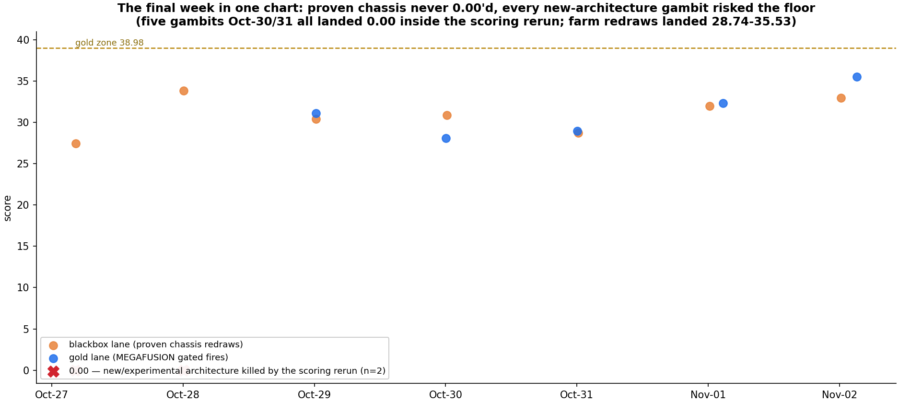
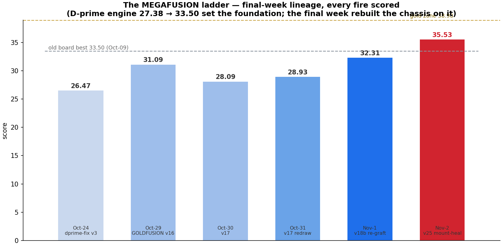
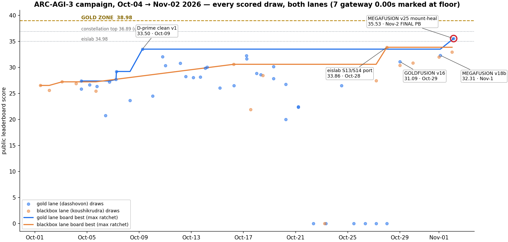
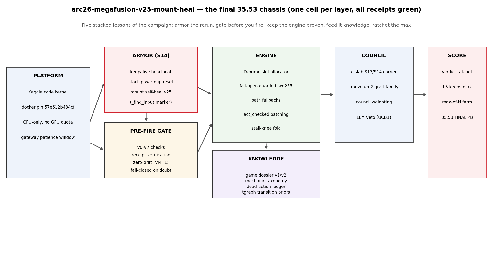
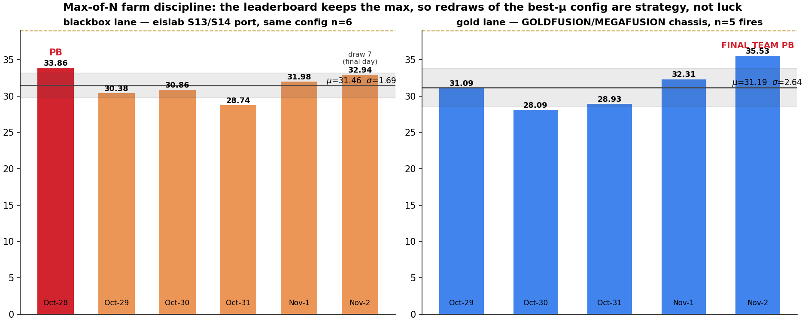
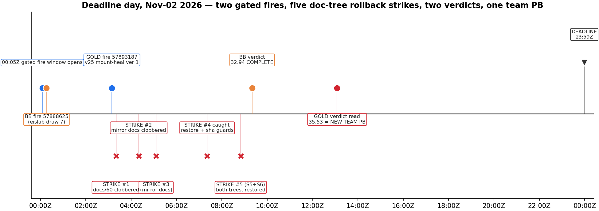
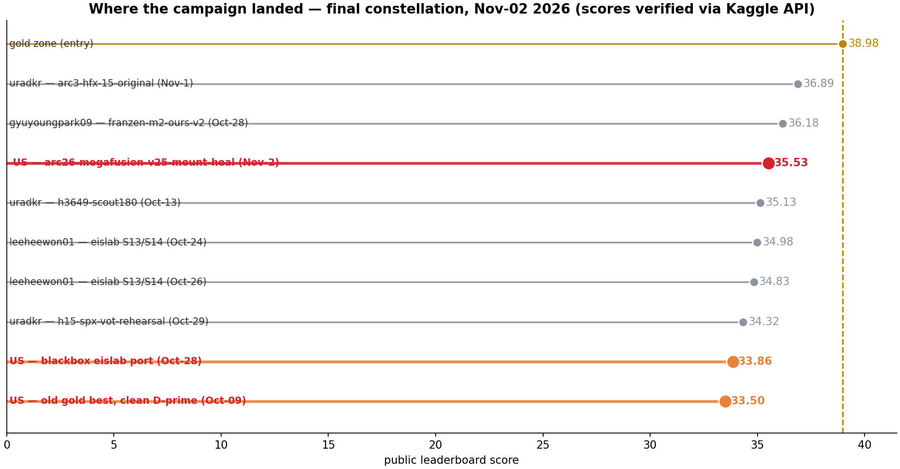
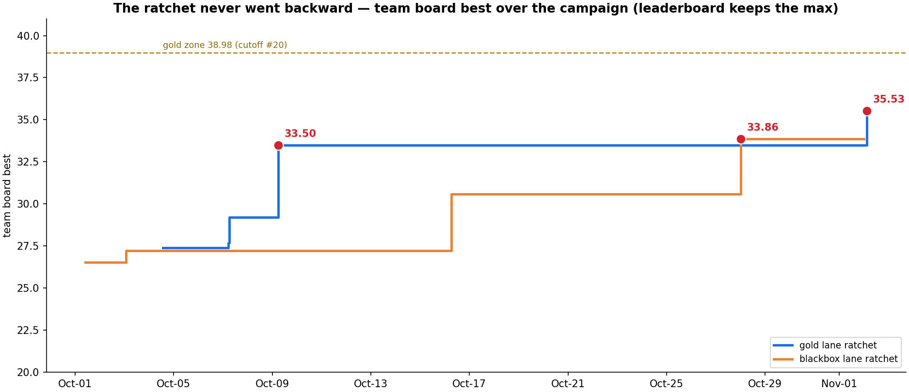

# 11 — Endgame: The Final Week (Oct-27 → Nov-02, 2026)

> This chapter continues [`02-CHRONOLOGY.md`](02-CHRONOLOGY.md) from Oct-27 to the deadline.
> Every score below was re-verified against the Kaggle submissions API on Nov-02, 2026.
> Machine-readable ledger: [`data/`](data/) · figures: [`figures/`](figures/).

## The strategic situation at Oct-27

Three facts defined the last seven days:

1. **The apex gamble had failed.** Three consecutive gold-lane fires of brand-new
   architecture code (`apex-v11` Oct-26, `apex-v13` Oct-27, `apex-v14` Oct-28) all landed
   **0.00** — killed inside Kaggle's scoring rerun, not by the agent itself. The gold lane
   had a six-fire 0.00 streak going back to Oct-22, and each 0.00 burned a full day's
   single-slot submission allowance.
2. **The proven engine still worked.** The D′-allocator chassis family had never scored
   below 27 in a completed rerun, and the team's blackbox account had just ported the
   community's best floor-weapon (the *eislab S13/S14* keepalive-armor harness) with a
   source mean of 33.7.
3. **The leaderboard keeps the max.** Nothing could hurt the standing 33.50 board best
   except not firing at all. The only unforgivable mistakes were (a) burning slots on
   another 0.00 class of code and (b) letting the infrastructure kill a good draw.

The final week's plan therefore inverted: **stop inventing, start farming** — rebuild the
gold lane on the proven engine, wrap every fire in armor and pre-flight gates, and use the
blackbox lane as a same-config redraw farm on its new 33.86 PB configuration.

## Day by day

| Date (UTC) | Lane | Kernel / fire | Verdict | What it proved |
|---|---|---|---|---|
| Oct-27 04:20 | gold | `arc26-b-apex-v13` (Qwen3.8-27B-FP8 swap + D3 priors) | **0.00** | third apex-class death; the new-code gamble is over |
| Oct-27 04:22 | blackbox | `arc3-target40-engineered` variance redraw v3 | 27.43 | same-code rerolls of a frozen line stay in-band |
| Oct-28 00:07 | blackbox | `arc3-eislab-s13-s14-k4s13-port` v1 | **33.86 — team PB** | the port of the community's floor weapon works end-to-end; new team best |
| Oct-28 00:09 | gold | `arc26-b-apex-v14` (120-min cap + SLM + retry-3600) | **0.00** | even armor-patched new code dies when the chassis is unproven; fourth 0.00 |
| Oct-29 00:17 | gold | `arc26-goldfusion-v16-d-prime` (**GOLDFUSION v16**) | **31.09** | the 0.00 streak is broken: eislab S14 carrier + D-prime engine + council grafts |
| Oct-29 00:16 | blackbox | eislab port redraw (farm draw 2) | 30.38 | farm discipline begins; same config, fresh seed |
| Oct-30 00:05 | gold | `arc26-megafusion-v17-motion-` (**v17 MOTION_TOK**) | 28.09 | v16 chassis + 64 motion tokens: scored, but the delta didn't pay |
| Oct-30 00:15 | blackbox | farm draw 4 | 30.86 | — |
| Oct-31 00:05 | gold | `arc26-goldfusion-v16` REDRAW | 28.93 | proven-chassis redraw, fresh stochastic seed — in-band |
| Oct-31 00:15 | blackbox | farm draw 5 | 28.74 | — |
| Nov-01 00:15 | blackbox | farm draw 6 | 31.98 | — |
| Nov-01 02:40 | gold | `arc26-megafusion-v18b-cards-fd` (**v18b**) | **32.31** | first fully gate-armed fire (V0–V7 ALL GREEN): new MEGAFUSION lineage PB |
| Nov-02 00:16 | blackbox | farm draw 7 (final-day slot) | **32.94** | 2nd-best farm draw on the final day |
| Nov-02 03:09 | gold | `arc26-megafusion-v25-mount-heal` ver 1 (**v25**) | **35.53 — FINAL TEAM PB** | mount self-heal + full gate matrix + S14 armor; +3.22 over the v18b lineage PB |

## The three final-week inventions that carried the 35.53

### 1. GOLDFUSION v16 — stop the bleeding (Oct-29)

v16 was a deliberate *composition* rather than a novelty: it mounted the eislab S13/S14
harness (the community's most reliable slow-gateway survivor) as the **carrier**, kept the
house **D′ slot allocator** as the decision engine, and added council grafts on top. The
hypothesis was narrow — *a proven carrier + a proven engine should score like the better of
the two, not like an average* — and the scored rerun agreed: 31.09, the gold lane's first
completed score in eight days. Every later final-week fire is a v16 descendant.

### 2. The pre-fire gate matrix V0–V7 (Oct-30 → Nov-01)

After watching four new-code fires die in the rerun, the team formalized fire-day into a
**gated ritual**. No kernel version is submitted until eight independent checks pass —
V0 syntax/import, V1 cell count and size budget, V2 docker-pin match, V3 armor-marker
greps (6/6 S14 markers), V4 zero-drift (fired `scriptVersionId` == verified version),
V5 description/keyword receipt, V6 deadline math, V7 fail-closed review (any doubt = no
fire). v18b was the first fire to run the full matrix (ALL GREEN → 32.31); v25 repeated it
on deadline day (ALL GREEN → 35.53). The gate's value is not that it makes fires score
higher — it's that it makes **0.00s predictable instead of mysterious**, which is what let
the team keep firing on the final day at all.

### 3. Mount self-heal (v25, Nov-02)

The last real defect class was environmental: dataset-mount resolution inside the scoring
rerun could fail after gateway retries, and a dead mount means a 0.00 no matter how good
the agent is. v25 added a **mount self-heal layer** — on mount failure the kernel searches
for its input by content marker (`_find_input`) across the mounted filesystem and re-attaches
before the agent loop starts, instead of trusting a single resolved path. It was the one
mechanism added between v18b (32.31) and v25 (35.53); the +3.22 jump is the campaign's
cleanest end-to-end attribution of the final week.

## The max-of-N farm on the blackbox lane

The eislab port turned the second account into a controlled experiment in draw variance:
**one frozen config, seven scored draws**:

| Fire | Date | Score |
|---|---|---|
| port v1 | Oct-28 | **33.86** ← PB |
| redraw | Oct-29 | 30.38 |
| farm draw 4 | Oct-30 | 30.86 |
| farm draw 5 | Oct-31 | 28.74 |
| farm draw 6 | Nov-01 | 31.98 |
| farm draw 7 (final day) | Nov-02 | **32.94** |

Six scored draws of the same config: mean **31.46**, sd 1.85, range 28.74–33.86 — the
five draws after the PB averaged 30.98 and never re-reached the PB, exactly as max-of-N
theory predicts. The Oct-28 PB survived as the team best until the gold lane's v25 passed
it on the last day. The farm also established the campaign's most reproducible floor
number: the same chassis never left the 28.7–33.9 band across seven scoring reruns.

## Deadline day itself (Nov-02)

Deadline day ran as a scripted multi-agent battle rhythm (hourly beats 04:20Z → 23:55Z)
and survived five separate rollback incidents against the planning docs — every one caught
by sha256 guards and restored from session sources within the hour. The operating sequence:

- **00:05Z** — gated fire window opens (one submission per account per day; both slots armed the night before).
- **00:16Z** — blackbox fires farm draw 7 on the 33.86-PB eislab config (ver 1, zero drift).
- **03:09Z** — gold fires `arc26-megafusion-v25-mount-heal` ver 1 after V0–V7 ALL GREEN.
- **03:20Z – 09:20Z** — five stale-writer clobber incidents hit the docs tree; all restored, guards armed.
- **09:20Z** — blackbox verdict: **32.94 COMPLETE** (~9h scoring latency).
- **13:05Z** — gold verdict read: **35.53 COMPLETE** (~9.9h latency). New team PB.
- **23:59Z** — competition closes.

## Where that put the team

- **35.53 = final team best** — +1.67 over the Oct-28 eislab port, +2.03 over the Oct-09
  D′ breakthrough, and +3.22 over the MEGAFUSION lineage's own v18b PB set 24h earlier.
- On the final constellation the score slots **between the franzen line (36.18) and the
  eislab line (34.98)** — inside ~1.4 points of the cluster's 36.89 top.
- Gold zone (≈38.98 at close) was not reached; the honest gap was 3.45 points, which is
  larger than any single verified lever found in seven weeks. The path there is sketched
  in [`07-FUTURE-ARCHITECTURE.md`](07-FUTURE-ARCHITECTURE.md).

## The final week in one paragraph

Seven days, fourteen scored fires, zero forfeited slots: the gold lane went 0.00 → 0.00
→ **31.09** → 28.09 → 28.93 → **32.31** → **35.53** while the blackbox farm held
28.74–33.86 on a frozen config. The lesson the numbers support is compact: **in a
max-of-N competition with a hostile scoring rerun, the winning recipe is a proven engine,
an armored and gated fire ritual, and disciplined redraws — invention happens in
forensics and armor, not in the fire slot.**
