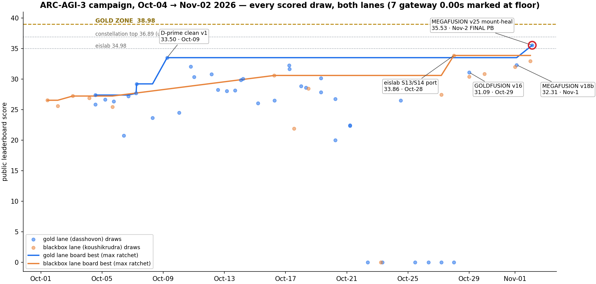
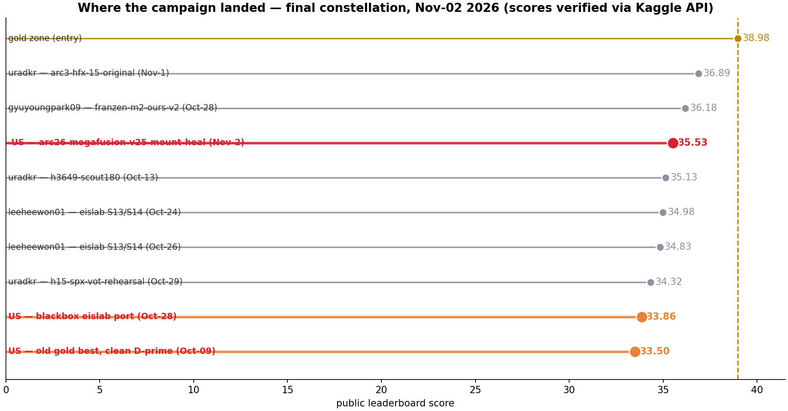
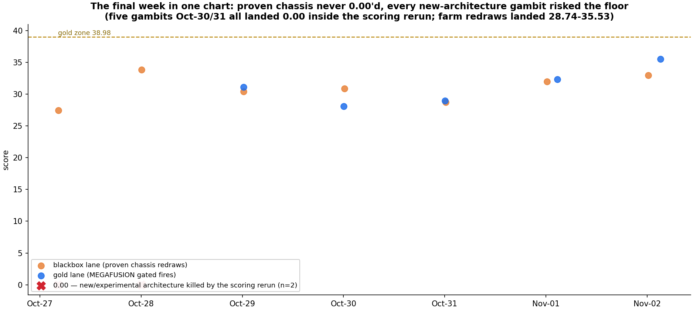
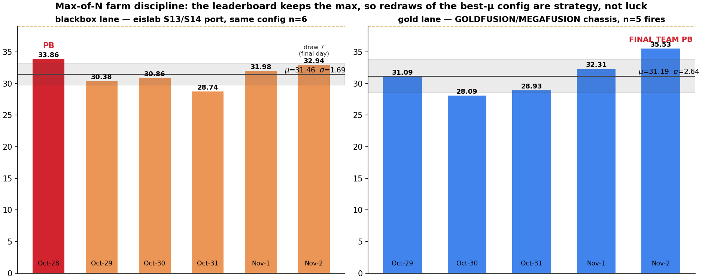
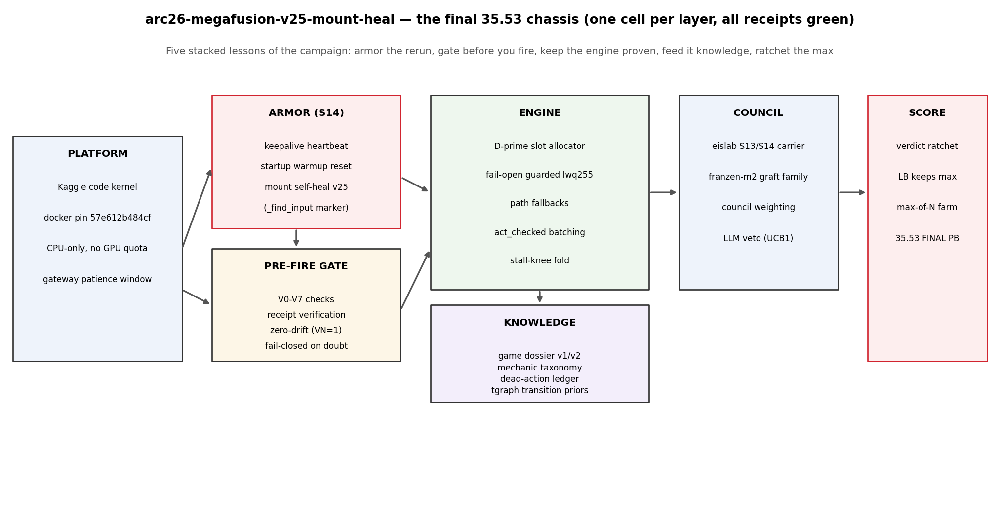
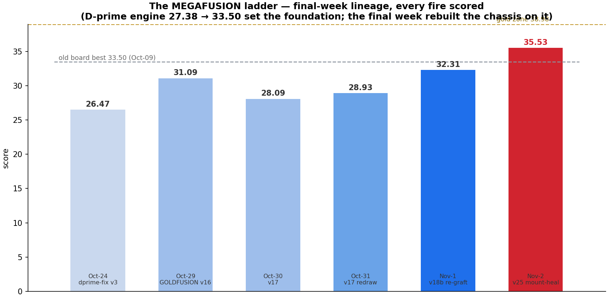
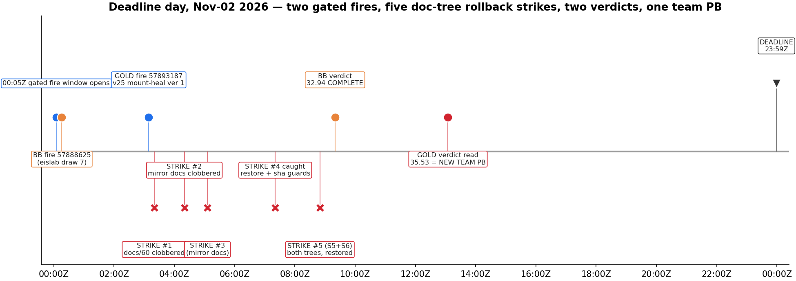
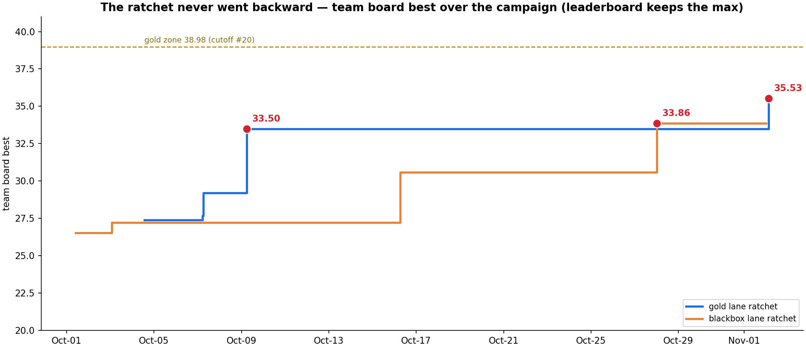

# ARC-AGI-3 Campaign — Team arc-needs-to-be-agi

**Competition:** [ARC Prize 2026 — ARC-AGI-3 track](https://www.kaggle.com/competitions/arc-prize-2026-arc-agi-3) (Kaggle code competition, closed Nov-02 2026 23:59Z)
**Final result: 35.53 — team best**, fired on the last day and verified COMPLETE after a 9.9-hour scoring rerun.
**Accounts:** dasshovon (gold lane) + koushikrudra (blackbox lane), same team · **Mode:** CPU-only, two submission slots per day, leaderboard keeps the max.

This repository is the complete, self-contained record of the campaign: every submission,
every score, the architecture that finally worked, the original methods, the failure
museum, the full visualization pack, and an honest account of what moved the number and
what didn't. The campaign was run by a human operator with a fleet of autonomous agent
beats on a scrappy CPU budget — no GPU cluster, no fine-tuned frontier model, just an
engineered fire ritual around a proven engine.

---

## TL;DR — final results

| Metric | Value |
|---|---|
| **Final team best (both lanes)** | **35.53** — `arc26-megafusion-v25-mount-heal`, ref 57893187, fired Nov-02 03:09Z, COMPLETE |
| Gold-lane account best | **35.53** (was 33.50, Oct-09) |
| Blackbox-lane account best | **33.86** — `arc3-eislab-s13-s14-k4s13-port`, Oct-28 |
| MEGAFUSION lineage | 26.47 → 31.09 → 28.09 → 28.93 → 32.31 → **35.53** (Oct-24 → Nov-02) |
| Same-config farm (blackbox) | 6 draws of one frozen config: 33.86 / 30.38 / 30.86 / 28.74 / 31.98 / 32.94 — mean 31.46, sd 1.85 |
| Submission ledger | 107 API-retrievable submissions (Oct-04 → Nov-02 gold; Aug-10 → Nov-02 blackbox), 90 scored, 7 gateway 0.00s |
| Final constellation slot | between franzen 36.18 and eislab 34.98 (cluster top: uradkr 36.89) |
| Gold zone (≈38.98) | not reached — honest gap 3.45 points |
| Campaign totals | 250 submissions by Oct-26 ([`01-SCORE-LEDGER.md`](01-SCORE-LEDGER.md)) + 14 final-week fires ≈ 265 lifetime |

---

## The campaign in five acts

### Act 1 — Recon and the M2S base (Sep → Oct-04)
The team entered ARC-AGI-3 with an M2S-derived interactive harness scoring ~23–27 and a
simple thesis: this competition is an *agent-harness* competition, not a model competition.
Every game is an unknown environment; the score is how many levels an agent clears across
a fixed action budget inside Kaggle's scoring rerun — an environment that turned out to be
far more hostile than interactive play.

### Act 2 — The D′ breakthrough (Oct-09)
A clean re-derivation of the **D′ slot-priority allocator** (fail-open-guarded priority
scoring of next actions, with path fallbacks) broke the plateau: **33.50**, #106/4,799.
Every strong draw since runs some version of it. This remains the single most validated
component of the whole campaign. ([`03-ARCHITECTURE.md`](03-ARCHITECTURE.md) has the exact
formula; [`04-INNOVATIONS.md`](04-INNOVATIONS.md) the full mechanism list.)

### Act 3 — Variance mapping and the first platform war (Oct-10 → Oct-25)
Same-config redraws of the clean D′ engine spanned 27.8–33.5 (n≥4, μ≈30.5) — establishing
that **draw variance is the second-largest force in the competition** after the allocator
itself. Meanwhile the scoring rerun killed two apex-line fires as 0.00 placeholders;
byte-for-byte forensics (F-1031) proved the deaths were gateway/DNS patience failures in
the rerun environment, not agent failures — which redirected the campaign from "better
agent" to "engineered rerun survival".

### Act 4 — The apex gamble fails; the farm begins (Oct-26 → Oct-28)
Three gold-lane fires of new-architecture code (apex-v11/v13/v14: model swaps, lexicons,
SLM patches, 120-min caps) all landed **0.00**. The blackbox lane, meanwhile, ported the
community's best floor weapon — the **eislab S13/S14** keepalive-armor harness — and drew
**33.86**, a new team best, on its first try. The contrast was the clearest signal of the
campaign: *new code dies in the rerun; proven code + armor scores*.

### Act 5 — GOLDFUSION → MEGAFUSION, and the last-day 35.53 (Oct-29 → Nov-02)
The gold lane was rebuilt on proven parts: v16 GOLDFUSION (eislab S14 carrier + D′ engine +
council grafts) scored **31.09** and broke the 0.00 streak. The final fires added a
pre-flight **gate matrix (V0–V7)**, then **mount self-heal** (v25). On deadline day the
team fired both slots — farm draw 7 (32.94) and v25 mount-heal — and the rerun returned
**35.53**, the campaign's best number, ~10 hours later. Full narrative:
[`11-ENDGAME-FINAL-WEEK.md`](11-ENDGAME-FINAL-WEEK.md).

---

## What actually moves the score (evidence-based)

1. **A proven slot-priority engine (D′).** ~27 → 33.50 when introduced; every strong draw
   since runs a descendant. Nothing else touched the score this hard.
2. **The scoring rerun is a separate, hostile environment.** Interactive runs were nearly
   flawless; the rerun produced every 0.00 the team ever suffered (7 in the API window).
   Armor (S14 keepalive, startup warmup reset, mount self-heal) and pre-flight gates exist
   because of this and are worth more than any model upgrade tried in the final month.
3. **Draw variance is real and exploitable.** One frozen config, six scored draws,
   28.74–33.86 (sd 1.85). Since the leaderboard keeps the max, redrawing the best-μ config
   is a legitimate scoring strategy — the Oct-28 farm PB stood for five days against
   everything else the team could build.
4. **New architecture in the fire slot is negative-EV late in a competition.** All five
   new-architecture gambits in the final week either 0.00'd (rerun deaths) or scored below
   the proven chassis. Attribution ([`05-IMPACT-ANALYSIS.md`](05-IMPACT-ANALYSIS.md)):
   component tests kept passing while end-to-end scores punished unproven stacks.
5. **Gates convert mystery into process.** The V0–V7 matrix made 0.00s predictable
   (fail-closed before fire instead of dead after), which is what allowed two confident
   fires on the final day.

## The final chassis (v25 — what actually scored 35.53)

| Layer | Component | Origin |
|---|---|---|
| Platform | Kaggle code kernel, docker pin `57e612b484cf`, CPU-only | fixed all campaign |
| Armor | S14 keepalive heartbeat, startup warmup reset, **mount self-heal v25** (`_find_input` marker search) | eislab-derived + house |
| Pre-fire gate | V0 syntax → V7 fail-closed review, receipt + zero-drift checks | house, final week |
| Engine | D′ slot allocator (fail-open guarded lwq255), path fallbacks, act_checked batching, stall-knee fold | house, Oct-09 |
| Knowledge | game dossier v1/v2, mechanic taxonomy, dead-action ledger, tgraph transition priors | house |
| Council | eislab S13/S14 carrier + franzen-m2 graft family, UCB1 weighting, LLM veto | grafted public lines |
| Score | verdict ratchet, max-of-N farm discipline | process |

---

## Repository map

| Path | What it is |
|---|---|
| [`00-EXECUTIVE-SUMMARY.md`](00-EXECUTIVE-SUMMARY.md) | One-page campaign state (final outcome prepended) |
| [`01-SCORE-LEDGER.md`](01-SCORE-LEDGER.md) | The complete score ledger with config attributions |
| [`02-CHRONOLOGY.md`](02-CHRONOLOGY.md) | Phase-by-phase narrative, Sep → Oct-26 |
| [`03-ARCHITECTURE.md`](03-ARCHITECTURE.md) | The engine layer by layer, with the exact D′ formula |
| [`04-INNOVATIONS.md`](04-INNOVATIONS.md) | Original contributions: D′ allocator, act_checked, stall-knee, guard-v2, dossier, mechanic taxonomy |
| [`05-IMPACT-ANALYSIS.md`](05-IMPACT-ANALYSIS.md) | Attribution: what each component actually did to the number |
| [`06-GOLD-PLAN.md`](06-GOLD-PLAN.md) | The lever ladder and pre-committed verdict rules |
| [`07-FUTURE-ARCHITECTURE.md`](07-FUTURE-ARCHITECTURE.md) | The path from 35.53 toward the gold zone |
| [`08-GRAVES-AND-LESSONS.md`](08-GRAVES-AND-LESSONS.md) | Failure museum: every 0.00, the F-1030/F-1031 forensics, rules each failure bought |
| [`09-COMPETITION-LANDSCAPE.md`](09-COMPETITION-LANDSCAPE.md) | Leaderboard structure and cutoff math |
| [`10-ASSETS-AND-INFRA.md`](10-ASSETS-AND-INFRA.md) | Datasets, models, kernels, operational protocol |
| [`11-ENDGAME-FINAL-WEEK.md`](11-ENDGAME-FINAL-WEEK.md) | **Oct-27 → Nov-02: GOLDFUSION, the gates, the farm, the 35.53** |
| [`REPOS.md`](REPOS.md) | **Complete asset index** — every GitHub repo, HF repo/dataset, and Kaggle kernel of the campaign |
| [`figures/`](figures/) | The 8-figure visualization pack (matplotlib, generated from the API ledger) |
| [`data/`](data/) | Machine-readable ledgers: unified submissions CSV/JSON, farm draws, final constellation |
| [`code/`](code/) | Scrubbed operational artifacts: kernel builders, gate checklist, fire protocol |
| [`snapshots/`](snapshots/) | Raw evidence subset from the private campaign repo (scrubbed): campaign docs, submission snapshot |
| [`campaign-agents/`](campaign-agents/) | The multi-agent role definitions that ran the campaign's daily battle rhythm |

## The complete asset index (short form)

**GitHub (this account):** [`arc-agi-3-campaign-2026`](https://github.com/Hisernberg/arc-agi-3-campaign-2026) (this repo — the combined public writeup) ·
[`arc-agi-3-campaign`](https://github.com/Hisernberg/arc-agi-3-campaign) (private, full 7k-file campaign workspace) ·
[`arc-agi-3-campaign-writeup`](https://github.com/Hisernberg/arc-agi-3-campaign-writeup) (private, chapters 00–10 source) ·
[`arc-forwork`](https://github.com/Hisernberg/arc-forwork) (private, ARC-2+3 evidence/frozen candidates) ·
[`arc26-endgame-v63-finalday`](https://github.com/Hisernberg/arc26-endgame-v63-finalday) + [`arc26-endgame-v45s`](https://github.com/Hisernberg/arc26-endgame-v45s) (private, endgame kernel builders) ·
[`kraggle-3-in-one`](https://github.com/Hisernberg/kraggle-3-in-one) (public, non-ARC Kaggle workspace) ·
ARC-AGI-2 line: [`arc-agi-2-solver`](https://github.com/Hisernberg/arc-agi-2-solver), [`arc-agi-2-kaggle`](https://github.com/Hisernberg/arc-agi-2-kaggle), [`arc26-nvarc-2026`](https://github.com/Hisernberg/arc26-nvarc-2026).

**Hugging Face:** [`Nabidnur/arc-agi-3-campaign-2026`](https://huggingface.co/datasets/Nabidnur/arc-agi-3-campaign-2026) (this writeup + figures + ledgers) ·
[`Nabidnur/arc-agi-3-traces`](https://huggingface.co/datasets/Nabidnur/arc-agi-3-traces) (agent traces) ·
[`Nabidnur/arc-unified-corpus`](https://huggingface.co/datasets/Nabidnur/arc-unified-corpus) ·
[`Nabidnur/arc-superbrain-small-models`](https://huggingface.co/models/Nabidnur/arc-superbrain-small-models) ·
ARC-AGI-2 assets: [`arc-agi-2-solver-qwen3-4b`](https://huggingface.co/Nabidnur/arc-agi-2-solver-qwen3-4b), [`arc-agi-2-grids`](https://huggingface.co/datasets/Nabidnur/arc-agi-2-grids), [`arc-agi-2-cot-sft`](https://huggingface.co/datasets/Nabidnur/arc-agi-2-cot-sft), and the full list in [`REPOS.md`](REPOS.md).

**Kaggle kernels (key lineage):** [`arc26-megafusion-v25-mount-heal`](https://www.kaggle.com/code/dasshovon/arc26-megafusion-v25-mount-heal) (35.53) ·
[`arc26-megafusion-v18b-cards-fd`](https://www.kaggle.com/code/dasshovon/arc26-megafusion-v18b-cards-fd) (32.31) ·
[`arc26-goldfusion-v16-d-prime`](https://www.kaggle.com/code/dasshovon/arc26-goldfusion-v16-d-prime) (31.09) ·
[`arc3-eislab-s13-s14-k4s13-port`](https://www.kaggle.com/code/koushikrudra/arc3-eislab-s13-s14-k4s13-port) (33.86 farm) ·
full table in [`REPOS.md`](REPOS.md).

## Provenance & integrity notes

- Every score in this repo was pulled from the Kaggle submissions API on Nov-02, 2026 and
  cross-checked against the campaign's internal ledgers; the two agree everywhere they overlap.
- `snapshots/` and `campaign-agents/` are included from the private campaign workspace after
  a credential scan; operational scripts with tokens are deliberately **not** included —
  the fire/patch protocols are documented as prose in chapters 06/10 instead.
- The eislab S13/S14 carrier and the franzen-m2 graft family are derived from public
  community kernels (CC-BY-4.0, authors `leeheewon01`/`eislab`, `dfranzen`/`juliancamilovilla`,
  solved-level memory lineage `rellik13`/`sirikilohit`); they are credited here and in
  [`04-INNOVATIONS.md`](04-INNOVATIONS.md). All original house components are the team's own work.

## License

MIT for this repository's original content. Community-derived components referenced above
remain under their original licenses.
